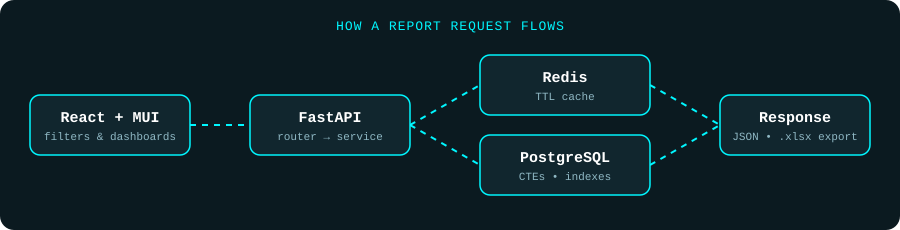

<div align="center">


<p>


</p>

</div>


## About Me

I'm a full-stack engineer who builds data-heavy product features end to end: PostgreSQL queries and indexes, FastAPI services, and React dashboards that operations teams use every day. Right now I work on a manufacturing analytics platform, focusing on reporting, OEE metrics, audit search, and query performance.

```yaml
Name:      Aakash Singh
Role:      Full-Stack Software Engineer
Company:   W3Villa
Project:   Kivo Eye (SSWL)
Working on: Production analytics, reporting systems, real-time dashboards, SQL performance
Strengths: FastAPI, React, PostgreSQL, Redis, SQLAlchemy
Learning:  FAISS, CUDA, TensorRT, Kafka, Kubernetes
Ask me:    FastAPI, React, PostgreSQL, Redis, JWT, Docker, WebSockets, Computer Vision,
           report and export workflows, index and query tuning
```


## Featured Project: Kivo Eye (SSWL)

A production-line analytics platform for a manufacturing environment. It combines live line monitoring, shift and run tracking, OEE reporting, production reports, audit history, PLC drive-current analytics, and notifications.

**Platform features:** live camera streams, WebSocket updates, line-run and shift tracking, production reports, audit logs, PLC analytics, email notifications, production metrics.

It is a multi-author codebase. Here is what I personally built:

| Area | What I built |
|---|---|
| **Reporting dashboard** | Paginated, shift-aware reporting API with Pydantic query validation, composite indexes, and a Material UI front end |
| **Production reports + Excel** | Contributed to a 13-endpoint reporting module (hourly loading vs OK, daily and monthly production, lot-wise tracking, dispatch/loading, loss dashboard) with formatted `.xlsx` exports via OpenPyXL |
| **OEE calculation** | Availability × Performance × Quality across shift, FTD (for the day), and FTM (for the month) windows |
| **Audit search** | Filterable, paginated audit service (hanger, shift, assignment, date range) with a 15-second Redis cache and a React UI |
| **PLC drive-current analytics** | 5/10/30-minute, hourly, shift, and daily buckets, per-drive peaks and averages, IST-aware shift mapping, and a threshold-based high-current event log |
| **Query and index optimization** | CTE-based SQL, partial and composite PostgreSQL indexes built with `CREATE INDEX CONCURRENTLY` so production writes aren't blocked, plus Redis caching for repeated report reads |
| **Scheduled jobs** | APScheduler storage-retention cleanup with throttled deletes and audit records |

<div align="center">



<br/><br/>


</div>


## Tech Stack

<div align="center">

**Languages**


**Frontend**


**Backend**


**Databases**


**DevOps**


**Tools**


</div>

### Currently Learning

<p>


</p>


## GitHub Stats

<p align="center">


</p>

> Most of my recent work lives in private repositories, so these cards undercount it.

## Contribution Snake

<p align="center">

</p>

## 3D Contribution Calendar

<p align="center">

</p>


## Connect With Me

<p align="center">
<a href="https://github.com/w3villa-aakash-singh"></a>
<!-- Uncomment and fill in your real links:
<a href="https://linkedin.com/in/YOUR_LINK"></a>
<a href="mailto:YOUR_EMAIL"></a>
-->
</p>

<p align="center">

</p>

<div align="center">

**Thanks for visiting!**

</div>


