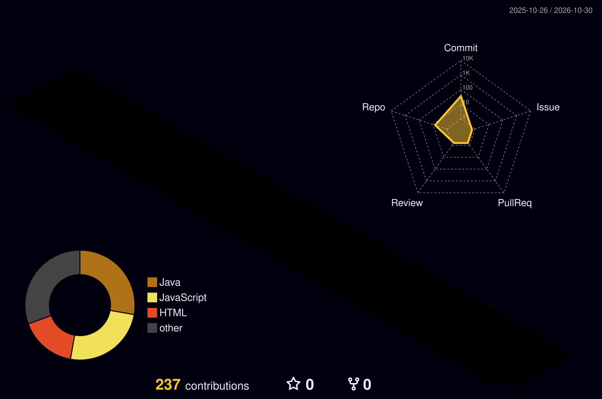

<div align="center">


<p>


</p>

<p>
<a href="#about-me"><b>About</b></a> &nbsp;|&nbsp;
<a href="#what-i-do"><b>What I Do</b></a> &nbsp;|&nbsp;
<a href="#featured-project-kivo-eye-sswl"><b>Project</b></a> &nbsp;|&nbsp;
<a href="#tech-stack"><b>Stack</b></a> &nbsp;|&nbsp;
<a href="#github-activity"><b>Activity</b></a> &nbsp;|&nbsp;
<a href="#connect-with-me"><b>Connect</b></a>
</p>



</div>


## About Me

I'm a full-stack engineer who builds data-heavy product features end to end: PostgreSQL queries and indexes, FastAPI services, and React dashboards that operations teams use every day. Right now I work on a manufacturing analytics platform, focusing on reporting, OEE metrics, audit search, and query performance.

```yaml
Name:       Aakash Singh
Role:       Full-Stack Software Engineer
Company:    W3Villa
Project:    Kivo Eye (SSWL)
Working on: Production analytics, reporting systems, real-time dashboards, SQL performance
Strengths:  FastAPI, React, PostgreSQL, Redis, SQLAlchemy
Learning:   FAISS, CUDA, TensorRT, Kafka, Kubernetes
Ask me:     FastAPI, React, PostgreSQL, Redis, JWT, Docker, WebSockets, Computer Vision,
            report and export workflows, index and query tuning
```


## What I Do

<table>
<tr>
<td width="33%" valign="top">

### Backend APIs

FastAPI routers, controllers, and services with Pydantic validation, JWT/API-key auth, pagination, filtering, response caching, and streamed file downloads.

</td>
<td width="33%" valign="top">

### Data and SQL

SQLAlchemy models, PostgreSQL CTEs, partial and composite indexes, non-blocking index migrations, and shift-window calculations that respect IST.

</td>
<td width="33%" valign="top">

### Dashboards

React + Material UI report pages, filter and modal workflows, Recharts visuals, and formatted Excel exports that replace manual raw-data work.

</td>
</tr>
</table>


## Featured Project: Kivo Eye (SSWL)

A production-line analytics platform for a wheel and paint manufacturing environment. It combines live conveyor monitoring, line-run and shift tracking, OEE reporting, production reports, audit logs, PLC drive-current analytics, camera streams, email notifications, and WebSocket updates.

**Stack:** FastAPI · SQLAlchemy 2 · PostgreSQL · Redis · Pydantic 2 · APScheduler · JWT · OpenPyXL · React 18 · Material UI · Recharts

It is a multi-author codebase. Everything below is what I personally built.

<div align="center">


<br/><br/>


<br/><br/>


</div>

### My contributions

| Area | What I built |
|---|---|
| **Reporting dashboard** | Paginated, shift-aware reporting API with Pydantic query validation, composite indexes, and a Material UI front end |
| **Production reports + Excel** | Contributed to a 13-endpoint reporting module with formatted `.xlsx` exports via OpenPyXL |
| **OEE calculation** | Availability × Performance × Quality across shift, FTD (for the day), and FTM (for the month) windows |
| **Audit search** | Filterable, paginated audit service with a 15-second Redis cache and a React UI |
| **PLC drive-current analytics** | Multi-bucket aggregation, per-drive peaks and averages, IST-aware shift mapping, and a high-current event log |
| **Query and index optimization** | CTE-based SQL, partial and composite indexes built with `CREATE INDEX CONCURRENTLY`, and Redis caching for repeated report reads |
| **Scheduled jobs** | APScheduler storage-retention cleanup with throttled deletes and audit records |

### The details

<details>
<summary><b>Reporting-lite dashboard</b></summary>
<br/>

- Paginated shift and run data with model and shift filtering, validated through Pydantic query schemas
- A dedicated backend query path plus a supporting index migration
- A Material UI page of roughly 1,400 lines, with its own test file

</details>

<details>
<summary><b>Production reports and Excel exports</b></summary>
<br/>

- Reports covered: hourly loading vs OK, daily production, monthly production, lot-wise tracking, dispatch/loading, and the loss dashboard
- Each report has filtering, pagination, server-side aggregation, and a formatted `.xlsx` export built with OpenPyXL
- Matching React report pages and API client methods
- Replaced several manual raw-data workflows with filterable UI reports

</details>

<details>
<summary><b>SQL and index optimization</b></summary>
<br/>

- Reworked line-run, paint-change, model-change, conveyor-stop, and missing-rim calculations into CTE-based SQL
- Added partial and composite PostgreSQL indexes through migrations
- Used `CREATE INDEX CONCURRENTLY` with invalid-index cleanup so production writes aren't blocked
- Added Redis TTL caching for repeated reads, with explicit invalidation groups

</details>

<details>
<summary><b>OEE KPI calculation</b></summary>
<br/>

- OEE = Availability × Performance × Quality, computed for shift, FTD, and FTM windows
- Performance logic uses expected output per hour, rim counts, actual runtimes, and inspection OK counts
- Wired into the OEE report table and page in the React app
- My part was the calculation work. The module was scaffolded and later revamped by teammates.

</details>

<details>
<summary><b>Audit-lite search</b></summary>
<br/>

- Search by hanger number, shift, assignment, and date range, with pagination
- A 15-second Redis cache and a supporting query-index migration
- A React interface of roughly 1,500 lines for operations users
- Gives operators a searchable history of hanger and line-run activity

</details>

<details>
<summary><b>PLC drive-current analytics</b></summary>
<br/>

- Buckets: 5, 10, and 30 minutes, hourly, per shift, and daily
- IST-aware shift mapping, per-drive averages and peaks
- A threshold-based high-current event log
- Targeted tests plus a substantially expanded React analytics page

</details>

<details>
<summary><b>Engineering practices</b></summary>
<br/>

- Every index change ships as a migration
- Targeted tests for caching, reporting-lite, OEE, PLC analytics, audit-lite, and history stats (130 passing)
- Layered structure: routes, controllers, services, schemas
- Cache invalidation designed alongside caching, not added later

</details>


## Tech Stack

<div align="center">


**Languages**


**Frontend**


**Backend**


**Databases**


**DevOps**


**Tools**


</div>

### Currently Learning

<p align="center">


</p>


## Earlier Projects

<p align="center">
<a href="https://github.com/w3villa-aakash-singh/Mini-Project-backend">

</a>
<a href="https://github.com/w3villa-aakash-singh/Mini-Project-frontend">

</a>
</p>


## GitHub Activity

<p align="center">


</p>

> Most of my recent work lives in private repositories, so these cards undercount it.

### Contribution Snake

<p align="center">

</p>

### 3D Contribution Calendar

<p align="center">

</p>


## Connect With Me

<p align="center">
<a href="https://github.com/w3villa-aakash-singh"></a>
<!-- Uncomment and fill in your real links:
<a href="https://linkedin.com/in/YOUR_LINK"></a>
<a href="mailto:YOUR_EMAIL"></a>
-->
</p>

<p align="center">

</p>

<div align="center">

**Thanks for visiting!**

</div>


